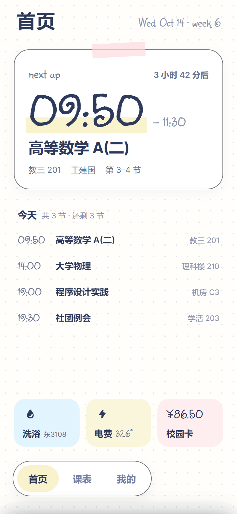
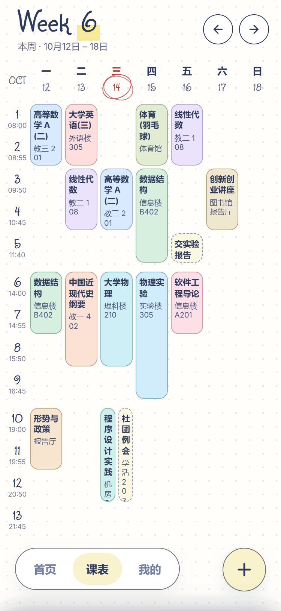
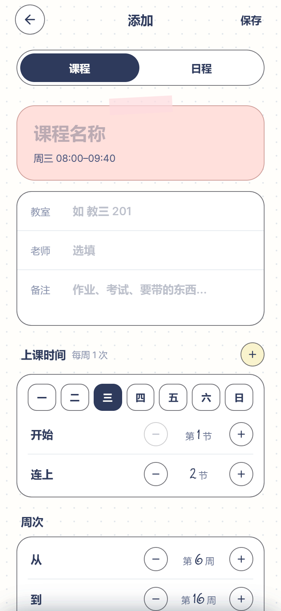
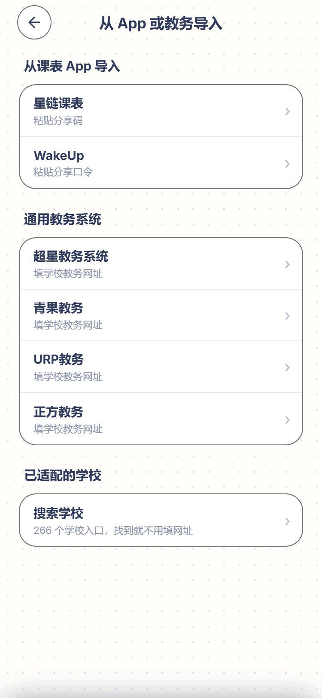

<div align="center">

# 📒 Planner

**一本装进手机里的手账课表。**

翻开就知道下一节在哪，导入只要一下，数据永远只在你自己手里。


<br/>






<sub>截图里的课程、名字、宿舍都是演示数据</sub>

</div>

---

## ✨ 它能做什么

### 📅 一眼看清这一周

- 周视图课表，**左右一划就换周**，「回本周」一键回来
- 时间撞车的课**并排摆开**，不会互相盖住
- 今天的日期画了圈；单双周、跨几段周次的课都认得
- 作息可以自己定：每段几节、课间休息多久、要不要留出饭点那一行

### 🏠 打开就知道下一节

首页会告诉你**下一节是什么课、在哪上**。今天的课上完了，它会让你早点休息。

### 📥 三种导入，总有一种适合你

| 方式 | 怎么用 |
| --- | --- |
| 🏫 **学校教务系统** | 支持正方、青果、URP、超星等**通用教务系统**（填学校教务网址即可），另有 **244 所学校**的专门适配；在 App 里登录教务系统就能把整学期课表拉回来 |
| 🔗 **分享码** | 从 WakeUp 课程表、星链课表复制分享内容，粘贴进来就好 |
| 📄 **PDF 课表** | 选一份教务导出的 PDF，**在手机上直接识别**，先给你看一张小课表预览，没认全的课单独列出来让你补全，导入后还能一键撤销 |

不管用哪种方式，导入前都会先预览，确认后才写进课表。

### 🎨 每门课都有自己的颜色

- 拖滑块调色，或者直接贴一个 HEX 色值
- 可以建自己的色卡、给它起名字，也能从文件导入别人的色卡

### 🔒 你的课表只属于你

- **没有服务器，没有账号。** 所有数据都存在手机本地
- 教务登录在独立的页面里完成，App **不保存**你的教务账号密码
- PDF 只在手机上读，**不上传**；导入后也只保存课程，不保存文件本身

### ✍️ 一点手作感

手绘风格的启动图标，开屏时会**划出一道荧光笔**再淡出。

### 🧾 还在路上

「我的」里预留了校园卡、电费、洗浴入口，**目前只有界面**，显示「未连接」，不会发起任何真实请求或支付。

---

## 🛠️ 技术栈

| 层 | 用的什么 |
| --- | --- |
| 界面 | React 19 + 手写 CSS 设计 token |
| 构建 | Vite 8 |
| 安卓外壳 | Capacitor 8（compileSdk / targetSdk 36，minSdk 24） |
| 本地存储 | Capacitor Preferences |
| PDF 识别 | PDF.js，在 App 内按文字位置还原课表网格 |
| 教务导入 | 独立 WebView + 拾光课程表桥接协议 |
| 测试 | Vitest，核心计算（周次、课表网格、色卡、存储、导入转换、PDF 识别）都有单元测试 |

---

## 🚀 自己跑起来

需要 **Node.js** 和 **JDK 21**（构建安卓包用）。

```bash
npm install        # 安装依赖
npm test           # 跑单元测试
npm run dev        # 在浏览器里预览界面
npm run sync       # 打包网页并同步进 android/
```

构建调试版 APK：

```bash
cd android
./gradlew assembleDebug    # Windows 用 .\gradlew.bat assembleDebug
```

生成的安装包在 `android/app/build/outputs/apk/debug/`。

---

## 🗂️ 目录速览

```
src/
├── pages/          各个页面：首页、课表、我的、课程编辑、导入……
├── lib/            纯计算与数据层（周次、网格、色卡、存储、导入、PDF 识别）
├── data/           内置的教务适配目录
├── nav.jsx         页面导航、弹层、安卓返回键
└── ui.jsx          通用组件
android/            Capacitor 安卓工程，含教务导入用的 WebView 宿主
public/             字体、图标、随包附带的开源适配脚本与许可证
design/app-icon/    启动图标的手绘 SVG 源稿
```

---

## 🙏 致谢

- **[拾光课程表适配仓库 shiguang_warehouse](https://github.com/XingHeYuZhuan/shiguang_warehouse)**（MIT）：教务适配脚本和学校目录都来自这里，感谢每一位适配维护者
- **[PDF.js](https://github.com/mozilla/pdf.js)**（Apache-2.0）：在手机上读懂 PDF 课表
- 字体 **Sunshiney** 与 **Inter**

完整的第三方许可与说明见 [`THIRD_PARTY_NOTICES.md`](THIRD_PARTY_NOTICES.md)。
